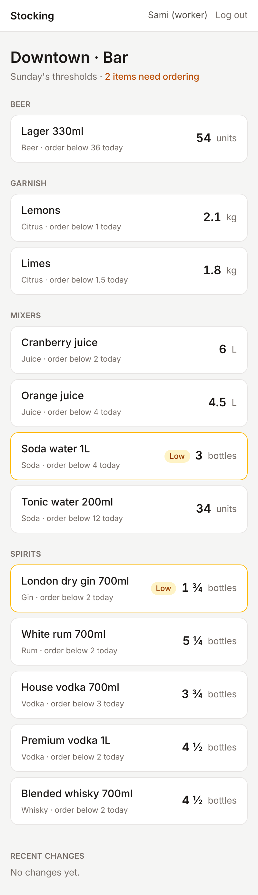
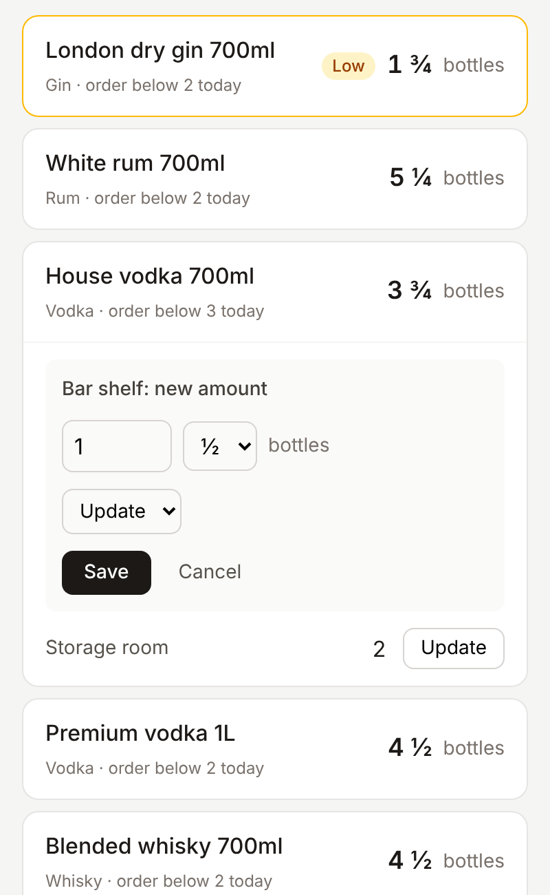
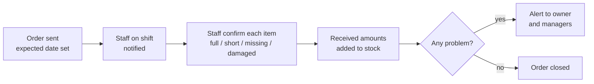

# Stocking

**Stock management for bars, cafés and restaurants.** Staff keep the bar's stock up to date from their phones; managers see what needs ordering before it runs out; owners see everything across their venues.

> The codebase is private while the product is in development. **Reviewers can get access on request**: contact me via [(https://www.linkedin.com/)](https://www.linkedin.com/in/hadeel-abbas/) or open an issue in this repo.

🚧 **Status:** in active development. The first working slice (log in → see the bar's stock → update amounts) is done.

 

---

## The problem

Bars track stock on paper or from memory. Items run out mid-shift, orders go out too late, and owners can't see where the money goes. Stocking gives every venue one shared, up-to-date picture of its stock and tells managers what to order and when.

## What works today

- **Roles:** worker, manager and owner. Each role includes everything below it; workers and managers see only their assigned venues, owners see all of them.
- **Bar screen:** items grouped by category and type, with the total across locations (bar shelf + storage room). Items under today's threshold are flagged **Low** and listed first.
- **Thresholds per day of the week**, e.g. 3 bottles Sunday–Wednesday and 6 Thursday–Saturday.
- **A business day that runs past midnight:** 2am Saturday still counts as Friday night.
- **Updating amounts** in ¼ steps for bottles and decimals for kg / L. Reasons: update, waste (broken, spilled, staff drink, free to a guest, expired), or correction (managers only).
- **An append-only change log:** who, when, old → new, and why. Reports will be built from it.

## System design (summary)

The full system description, covering every rule and edge case, is available to reviewers on request. A few highlights:

### Roles

| Can… | Worker | Manager | Owner |
|---|:---:|:---:|:---:|
| See and update stock in their venue | ✓ | ✓ | ✓ |
| Confirm deliveries during their shift | ✓ | ✓ | ✓ |
| Correct mistakes, set thresholds, send orders | | ✓ | ✓ |
| Manage shifts and events, see reports | | ✓ | ✓ |
| Add staff and change their access, see all venues | | | ✓ |

### Delivery flow



### Rules that shaped the design

- **Ordering accounts for delivery time.** An item is suggested for ordering when its stock would drop below the threshold before a delivery could arrive, using each supplier's lead time and delivery days.
- **One full count per shift.** Everyone on shift is reminded; one person claims the count; if the shift ends with no count, managers are notified.
- **Deliveries need proof.** The worker attaches a photo of the delivery note; short, missing or damaged items stay open on the order and alert the managers.
- **Order unit ≠ count unit.** Beer is ordered in cases of 24 but counted in bottles; each item stores the conversion.
- **Prices keep their history,** so last year's reports use last year's prices.

## Tech stack

Next.js 15 (App Router, Server Actions) · TypeScript · PostgreSQL · Drizzle ORM · Tailwind CSS · Vitest

## How a stock update works

```
"Save" → Server Action → check session → check the user's role in this venue
       → validate the amount → lock the stock row (SELECT … FOR UPDATE)
       → write the new amount + a log entry in one transaction → refresh the page
```

## Design decisions

- **Permissions are checked on the server for every action**, never only by hiding buttons in the UI.
- **Row locking for concurrent saves.** Two bartenders saving the same item at the same moment are applied one after the other, and each log entry records the amount it actually replaced.
- **Consumption is derived, not entered:** previous amount + deliveries − current amount. Staff never type it, so it can't drift.
- **Stock per location, total per item.** A bar can split stock between the shelf and a storage room.
- **Sizes are separate items, grouped by type:** "Vodka 700ml" and "Vodka 1L" each have their own amount and threshold.
- **Sessions:** the browser holds a random token in an http-only cookie; the database stores only its SHA-256 hash, so a leaked database row can't be used to log in.
- **Business rules are plain functions** (roles, amount validation, thresholds, business day), unit-tested without a database.

## Roadmap

| Stage | Status |
|---|---|
| Login, venues, roles | ✅ Login and roles · ⬜ owner sign-up, inviting staff |
| Items and stock updates | ✅ Done · ⬜ full count once per shift |
| Orders screen, suggested quantities, WhatsApp export | ⬜ |
| Weekly shift schedule | ⬜ |
| Deliveries: shift notifications, confirmation, missing/damaged alerts | ⬜ |
| Events calendar | ⬜ |
| Consumption and cost reports | ⬜ |
| Later | AI order prediction · kitchen with shelf life · mobile app |

---

Built by **Hadeel Abbas**, CS student at the University of Haifa.
